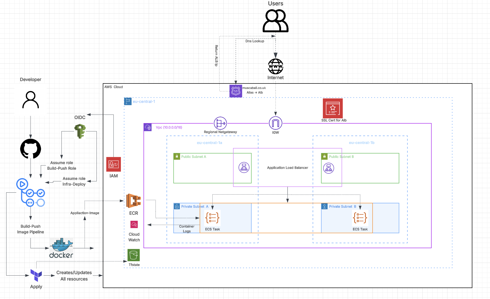
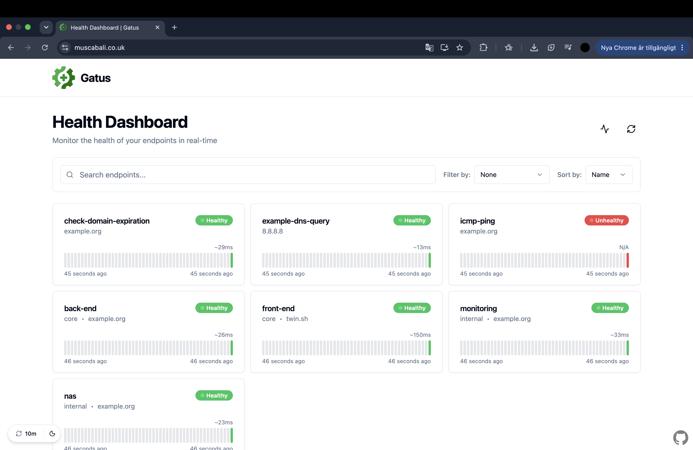
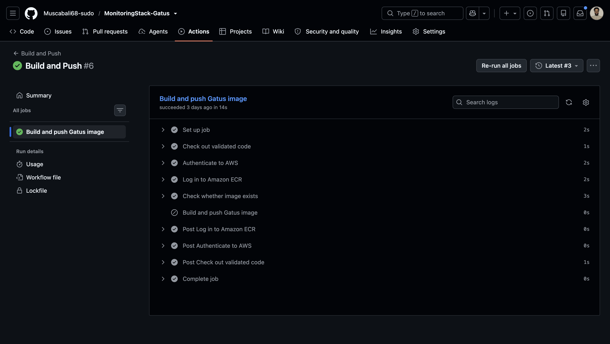
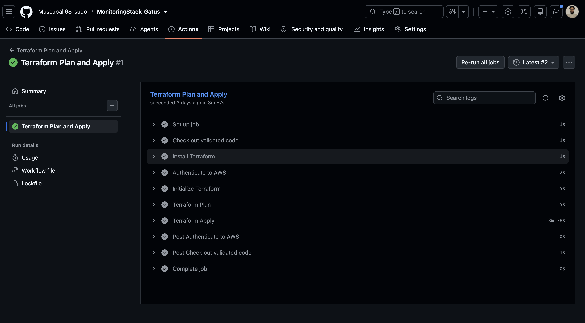
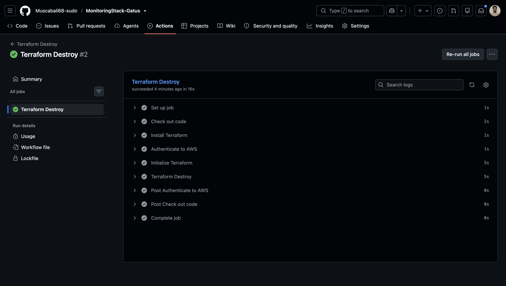
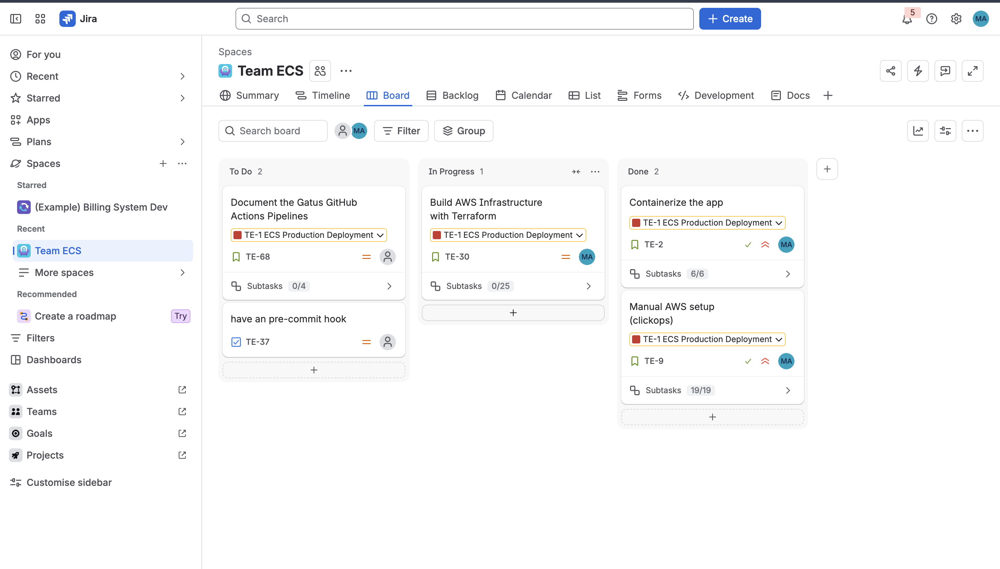
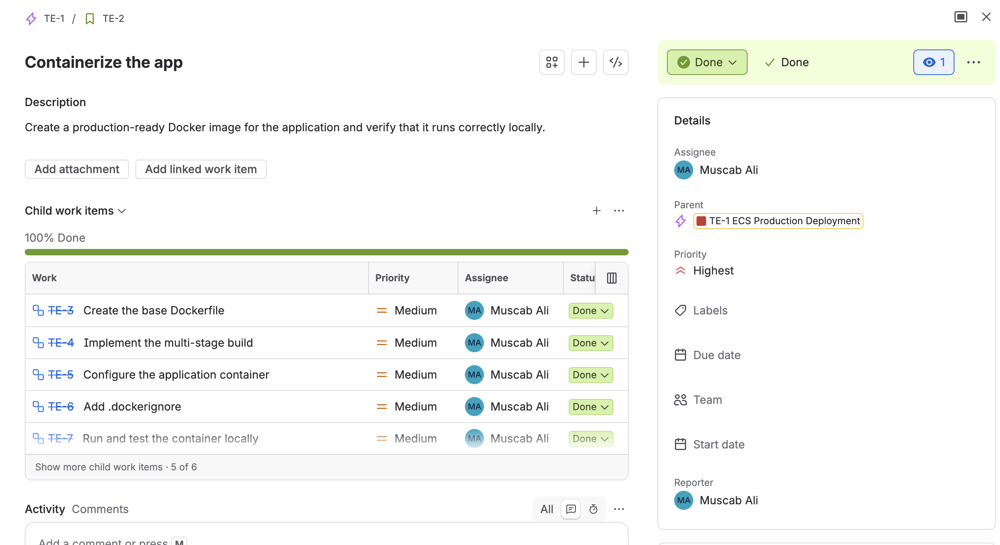
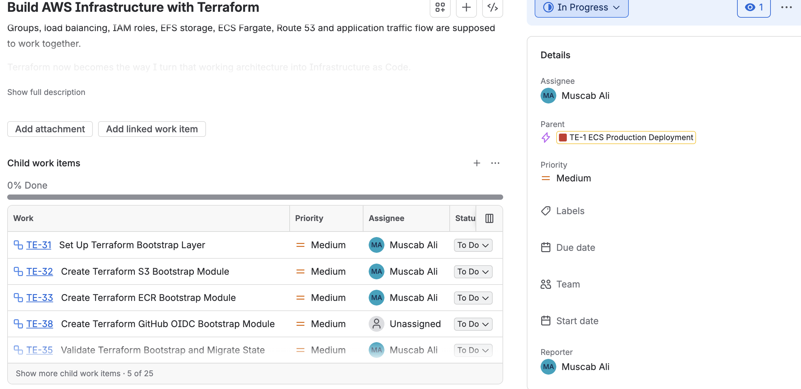

# Gatus Monitoring Platform on AWS 




---

## Table of Contents

- [Overview](#overview)
- [Application URL](#application-url)
- [The Big Four Questions](#the-big-four-questions)
- [Architecture Overview](#architecture-overview)
- [Features](#features)
- [Repository Structure](#repository-structure)
- [Key Components](#key-components)
- [Cost & Availability Decisions](#cost--availability-decisions)
- [CI/CD Pipelines](#cicd-pipelines)
- [Project Delivery](#project-delivery)
- [Local Setup](#local-setup)
- [Troubleshooting Log](#troubleshooting-log)
- [Future Improvements](#future-improvements)

---

## Overview

A production-style monitoring platform built on AWS ECS Fargate, running Gatus through a secure Multi-AZ architecture with public and private subnets. Designed to provide a reliable and repeatable deployment environment, with application traffic routed through an Application Load Balancer and secured using Route 53 and ACM-managed HTTPS.

Infrastructure is provisioned through modular Terraform with remote state and native locking in Amazon S3, while GitHub Actions automates container builds, image delivery, and infrastructure deployment and destroy. Docker images are stored in Amazon ECR and run as ECS tasks within private subnets, with application configuration persisted on Amazon EFS. AWS OIDC enables secure CI/CD authentication without long-lived credentials, creating an automated delivery workflow from source code through to running infrastructure.

---

## Application URL

→ **https://muscabali.co.uk/**

<!-- The screenshot must show the padlock / HTTPS in the browser address bar -->


---

## The Big Four Questions

### 1. What is this application?

**Gatus** is an open-source, self-hosted health monitoring tool written in Go. Endpoints such as websites and API health routes are declared in a single YAML file. Gatus sends requests to each endpoint at a defined interval and evaluates the response against configurable conditions, including:

- Expected HTTP status codes, such as `200`
- Maximum response times
- Required content within the response body

When a check fails, whether through a `500` error, a timeout, or an unreachable host, Gatus marks the endpoint as unhealthy on its dashboard. Alerts can be configured to notify on failure.

The application runs as a single binary, reads one configuration file, listens on port `8080`, and serves a web dashboard showing every monitored endpoint with its current status and recent history.

Gatus identifies that an endpoint is failing, not why. Root-cause analysis across the application, server, or network remains a separate investigation.

> [!NOTE]
> The application source in `gatus/` is the open-source Gatus project, with its original licence retained. The Dockerfile, Terraform infrastructure, and CI/CD pipelines in this repository are original work.

### 2. Why was this application chosen?

Manually visiting each website or service to confirm availability does not scale, and outages are only noticed by chance. A centralised dashboard that checks continuously and reports every endpoint in one place removes that gap.

Gatus was selected for the following reasons:

- **Container-friendly:** a compiled Go binary packages into a very small image
- **Meaningful state:** a single configuration file provides a genuine use case for persistent storage with EFS, without introducing an unnecessary database
- **Simple ingress:** one listening port makes load balancer routing and health checks straightforward
- **Practical value:** a monitoring service has to stay available, which justifies running it on managed cloud infrastructure rather than a personal machine

### 3. Why ECS instead of a standard VM or a free host such as Vercel or Netlify?

**Vercel and Netlify** are designed for static sites and short-lived serverless functions. Gatus is a long-running process that runs its own scheduled check loop and reads configuration from a file system. This does not map to a request-driven function model, and these platforms offer no control over private networking, storage, or load balancing.

**A standard VM** would run Gatus, but it would also require ownership of operating system patching, process supervision, and recovery. A single VM is also a single point of failure, which undermines a service whose purpose is to report on availability.

**ECS Fargate** addresses these gaps:

- No servers to provision, patch, or size
- The ECS service maintains the desired task count and replaces failed tasks automatically
- Task IP addresses are registered with the ALB target group without manual changes
- Tasks run in private subnets behind a load balancer, following a standard production pattern
- Native integration with ECR, EFS, IAM, and CloudWatch

> [!NOTE]
> For a small, always-on workload, a single VM is typically cheaper. Fargate was selected for its self-healing service model and production-style network design. See [Cost & Availability Decisions](#cost--availability-decisions).

### 4. How many users are there, or how many are expected?

This is a portfolio project, so it only serves a handful of users.

I still designed it to be reliable. The network uses two Availability Zones (`eu-central-1a` and `eu-central-1b`). The load balancer sits in the public subnets and the ECS tasks sit in the private subnets. This means the project does not depend on one single data centre location.

Two zones alone are not enough, though. If the service runs only one task, that task is still a single point of failure. To fix this, I made the task count a Terraform variable. Running more tasks across both zones only needs a variable change and a redeploy. No redesign is needed.

I did not set up auto scaling yet and that was on purpose. Gatus is very light. Most of its work comes from the checks it sends out, not from people opening the dashboard. For a handful of users, auto scaling would add extra cost and extra work without any real benefit. First I would check the real usage and cost. If usage grows, I would add scaling based on CPU and memory. This is listed under Future Improvements.

I followed production-style decisions, but kept the size small to match the real usage.


---

## Architecture Overview

The platform runs in a custom `10.0.0.0/16` VPC spanning two Availability Zones in `eu-central-1`, using a standard public and private subnet layout.


- Public subnets hosting a multi-AZ Application Load Balancer as the only public entry point
- Private subnets running ECS Fargate tasks and Amazon EFS mount targets, with no public IP addresses
- A Regional NAT Gateway providing outbound connectivity across both Availability Zones for endpoint health checks
- HTTP to HTTPS redirect enforced at the ALB, using an ACM certificate validated through Route 53
- Container images stored in Amazon ECR with scan on push and Git SHA versioning
- Gatus configuration persisted on encrypted Amazon EFS, independent of the task lifecycle
- Infrastructure provisioned through modular Terraform with remote state and native locking in Amazon S3


---

## Features

- Infrastructure provisioned using **Terraform** modules
- Remote Terraform state stored in **Amazon S3** with versioning, encryption, and **native lockfile locking**
- Custom **VPC** with two public and two private subnets across multiple Availability Zones
- **Regional NAT Gateway** for outbound access from private subnets
- Multi-stage Docker build on a minimal **Distroless** non-root runtime image
- Private **Amazon ECR** repository with scan on push and encryption
- **ECS Fargate** service running in private subnets with no public IP addresses
- **Application Load Balancer** with automatic HTTP to HTTPS redirect
- **HTTPS** using **AWS Certificate Manager (ACM)**, with the certificate created and validated by Terraform
- Custom domain and DNS records managed in **Route 53**
- Persistent configuration on encrypted **Amazon EFS**
- Separate IAM roles for task execution and application permissions
- Three **GitHub Actions** pipelines for image build, infrastructure deployment, and teardown
- **GitHub Actions** authentication using **AWS OIDC** (no long-lived AWS credentials)

---

## Repository Structure


```
gatus-monitoring-stack/
├── .github/
│   └── workflows/
│       ├── build-push.yml         # Build and push container image to ECR
│       ├── deploy.yml             # Terraform init, validate, plan, and apply
│       └── destroy.yml            # Terraform infrastructure teardown
├── gatus/                         # Application
│   ├── Dockerfile                 # Multi-stage build with Distroless non-root runtime
│   ├── config.yaml                # Gatus endpoint configuration
│   ├── main.go                    # Application entry point
│   ├── go.mod / go.sum            # Go module dependencies
│   └── ...                        # Gatus source packages (alerting, api, client, controller, web, etc.)
│
├── Infra/
│   ├── Bootstrap/                 # Foundational resources required before the main deployment
│   │   ├── main.tf
│   │   ├── variables.tf
│   │   ├── provider.tf
│   │   └── modules/
│   │       ├── s3/                # Terraform remote state bucket
│   │       ├── ecr/               # Container image repository
│   │       └── oidc/              # GitHub OIDC provider and IAM role
│   │
│   ├── main.tf                    # Root module wiring all infrastructure modules together
│   ├── variables.tf
│   ├── provider.tf                # AWS provider, version constraints, S3 backend
│   └── modules/
│       ├── vpc/                   # VPC, subnets, IGW, Regional NAT, route tables
│       ├── sg/                    # ALB, ECS, and EFS security groups
│       ├── alb/                   # ALB, target group, HTTP and HTTPS listeners
│       ├── acm/                   # TLS certificate and DNS validation
│       ├── route53/               # Alias record pointing to the ALB
│       ├── iam/                   # Task execution role and task role
│       ├── efs/                   # Encrypted file system and mount targets
│       └── ecs/                   # Cluster, task definition, and service
│
├── assets/                        # Architecture diagram and screenshots used in this README
├── .gitignore
└── README.md
```

---

## Key Components

### Containers & Runtime

- Multi-stage Docker build: a `golang:alpine3.24` stage compiles the Gatus binary, and only the binary and configuration file are copied into the final image
- Final image based on `gcr.io/distroless/static-debian13:nonroot`, removing the compiler, shell, and build tooling from the runtime
- Container runs as a **non-root user**, reducing unnecessary runtime privileges
- Smaller images reduce ECR storage, speed up Fargate image pulls, and limit the number of components that can introduce vulnerabilities
- Images are versioned using immutable Git commit SHA tags

> [!NOTE]
> ECS Fargate was selected to provide managed container compute without provisioning or maintaining EC2 worker instances.

### Networking & Ingress

- Custom `10.0.0.0/16` VPC spans `eu-central-1a` and `eu-central-1b`
- Public subnets host the internet-facing **Application Load Balancer**, routed through an Internet Gateway
- Private subnets isolate **ECS Fargate tasks** from direct internet access, with `assign_public_ip = false`
- A **Regional NAT Gateway** provides outbound connectivity, which Gatus requires to reach monitored endpoints
- HTTP traffic is redirected to HTTPS before being forwarded to healthy ECS targets
- An IP-based target group (`gatus-tg`) forwards traffic on port `8080`, with ALB health checks determining target health

| Security Group | Inbound | Source |
|---|---|---|
| ALB | 80, 443 | Internet |
| ECS | 8080 | ALB security group only |
| EFS | 2049 (NFS) | ECS security group only |

> [!IMPORTANT]
> HTTPS secures the connection between the browser and the ALB. Traffic between the ALB and ECS tasks uses HTTP on port 8080 within the VPC.

### DNS & TLS

- **Route 53** manages DNS for the application domain, with an Alias record pointing to the ALB
- **AWS Certificate Manager (ACM)** provides the TLS certificate used by the HTTPS listener
- The certificate is requested and validated through DNS by Terraform, removing any manual certificate step
- An explicit `depends_on = [module.acm]` ensures the HTTPS listener is only created once the certificate is available

### Persistent Storage

- Fargate tasks are ephemeral, so local container storage cannot be relied on for configuration
- The Gatus configuration is stored on an encrypted **Amazon EFS** file system and mounted at `/config/config.yaml`
- EFS mount targets sit in both private subnets, and access is limited to NFS traffic from the ECS security group
- Replacement tasks mount the same file system and read the same configuration

### Terraform & State Management

- Infrastructure is provisioned through reusable **Terraform modules**: `vpc`, `sg`, `alb`, `acm`, `route53`, `iam`, `efs`, and `ecs`
- Configuration is split into `bootstrap` and `infra`, since the state bucket must exist before it can serve as a backend
- Each configuration uses a separate state key, so application changes cannot affect foundational resources
- Remote state is stored in **Amazon S3** (`gatus-bootstrap-terraform-state`) with versioning, AES-256 encryption, and `BucketOwnerEnforced` ownership
- Native S3 state locking with `use_lockfile = true` prevents concurrent state modifications
- Terraform and AWS provider versions are pinned for predictable runs
- The root module connects modules through outputs and inputs, for example `vpc_id = module.vpc.vpc_id`

> [!IMPORTANT]
> Remote state and state locking protect the shared Terraform state from conflicting infrastructure changes.

### Security

- **GitHub Actions OIDC** provides temporary AWS credentials without long-lived access keys
- The IAM trust policy controls which GitHub identity can assume the role, while the permission policy defines what the role can do
- The ECS task execution role (image pull, log delivery) is separate from the task role (application permissions)
- ECS tasks run privately, as a non-root user, and accept traffic only from the ALB
- ECR image scanning on push, plus encryption on ECR, EFS, and the state bucket
- No secrets are hardcoded in the repository

---

## Cost & Availability Decisions

- **Two Availability Zones** remove dependence on a single physical location
- **ECS Fargate** avoids the operational overhead of managing EC2 container hosts
- A **Regional NAT Gateway** simplifies outbound networking across both zones, with hourly and data processing charges
- **EFS** keeps configuration independent of the container lifecycle, at the cost of additional storage charges
- The **Terraform Destroy** workflow removes the environment when it is no longer required

| Decision | Main Benefit | Trade-off |
|---|---|---|
| Two Availability Zones | Foundation for multi-AZ resilience | More resources to pay for |
| Regional NAT Gateway | Simpler outbound design | Usage and data processing charges |
| ECS Fargate | No servers to manage | Pay for allocated CPU and memory while running |
| Amazon EFS | Persistent storage independent of containers | Storage cost and mount configuration |
| Private ECS tasks | No direct internet exposure | Requires NAT for outbound traffic |
| Application Load Balancer | Single entry point with health checks | Hourly and traffic charges |
| S3 remote state | Shared, versioned state | Additional resource to protect |

> [!NOTE]
> Two Availability Zones provide the foundation for high availability, but a single running task remains a single point of failure. Running multiple tasks across both zones is a change to the desired count variable.

---

## CI/CD Pipelines

This project uses three GitHub Actions workflows with a clear separation of responsibility. All three authenticate to AWS through OIDC.

### 1) Build and Push to ECR

- Triggered by changes to the application code
- Authenticates to AWS via OIDC and logs in to ECR
- Builds the container image and tags it with the Git commit SHA
- Pushes the image to ECR, where scan on push runs

> [!IMPORTANT]
> This pipeline publishes the image only. It does not update the running ECS service.

<!-- Replace OWNER/REPO. Badges render once the workflows exist on main -->
[](https://github.com/Muscabali68-sudo/MonitoringStack-Gatus/actions/workflows/build-push.yml)



### 2) Deploy Infrastructure

- Authenticates to AWS via OIDC
- Initialises Terraform against the S3 remote backend
- Validates the configuration and generates an execution plan
- Applies the changes to provision or update the AWS infrastructure

[](https://github.com/Muscabali68-sudo/MonitoringStack-Gatus/actions/workflows/deploy.yml)



### 3) Destroy Infrastructure

- Authenticates to AWS via OIDC
- Initialises Terraform to load the existing state from S3
- Destroys the infrastructure managed by the `infra` configuration

Teardown is kept as a separate workflow so that removing infrastructure is always a deliberate action. Bootstrap resources (state bucket, ECR, OIDC) are managed separately and are not affected.

[](https://github.com/Muscabali68-sudo/MonitoringStack-Gatus/actions/workflows/terraform-destroy.yml)



---

## Project Delivery

The project was planned and tracked in Jira as a structured engineering delivery.

- Work was organised into epics: containerisation, AWS infrastructure, application deployment, Terraform, security and authentication, CI/CD, and documentation
- Each epic was broken into tasks with milestones and deadlines, for example the ECS epic covering the cluster, task definition, service, target group integration, and IAM
- Task dependencies were tracked so that work was sequenced correctly, for example VPC before ECS, and ALB with security groups before traffic validation
- Errors and resolutions were documented as they occurred, forming the troubleshooting log below

<!-- Add a Jira board screenshot at assets/jira-board.png -->




---

## Local Setup

**Prerequisites:** Docker installed on your machine.

#### 1. Clone the Repository

```bash
git clone https://github.com/Muscabali68-sudo/MonitoringStack-Gatus
cd REPO
```

#### 2. Build the Image

```bash
docker build -t gatus ./gatus
```

#### 3. Run the Container

```bash
docker run -d --name gatus -p 8080:8080 gatus
```

#### 4. Access the Application

```
http://localhost:8080
```

#### 5. Stop the Application

```bash
docker stop gatus
docker rm gatus
```

Monitored endpoints are defined in `gatus/config.yaml`. In AWS, the same file is served from EFS.

---

## Future Improvements

Potential improvements to further mature the platform include:

- Introduce ECS Auto Scaling based on `CPU` and `memory` utilisation, with tasks distributed across both Availability Zones
- Add a Terraform plan pipeline with `terraform fmt`, `tflint`, and security scanning on pull requests
- Apply an ECR lifecycle policy to remove unused images
- Add separate `dev` and `prod` environments with controlled promotion between stages
- Extend observability with `CloudWatch` alarms and dashboards for application and infrastructure monitoring
- Implement `AWS WAF` in front of the ALB to strengthen application-layer security
- Add VPC endpoints, such as the S3 gateway endpoint, to reduce NAT data processing charges

